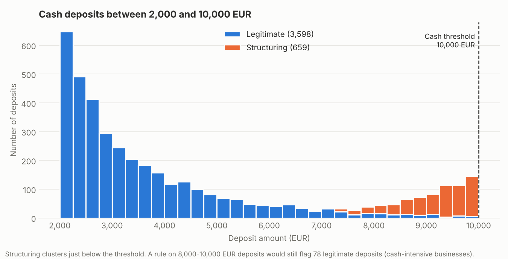
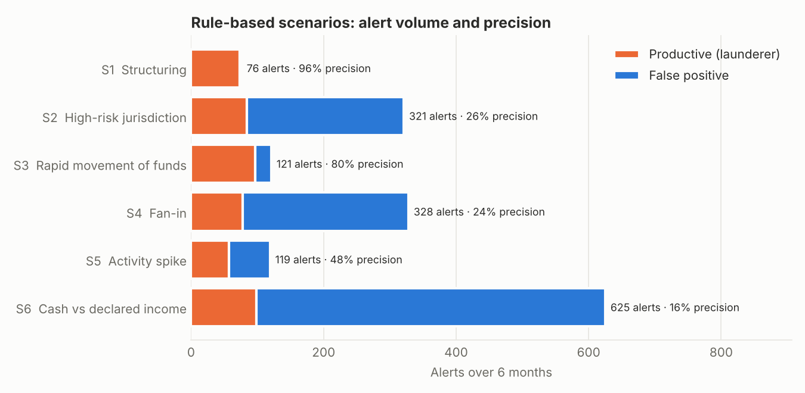
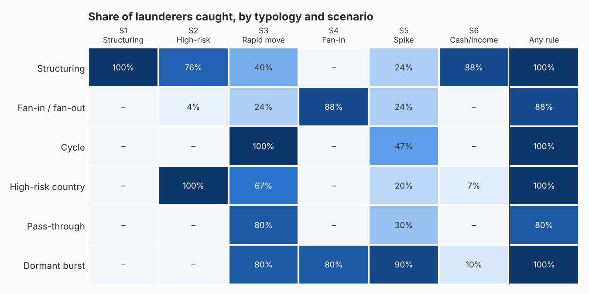
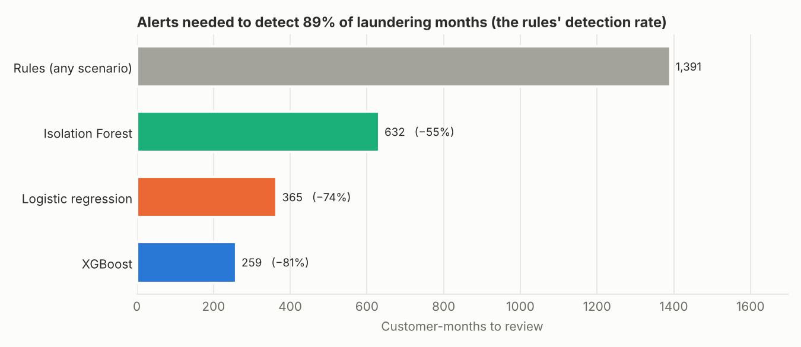
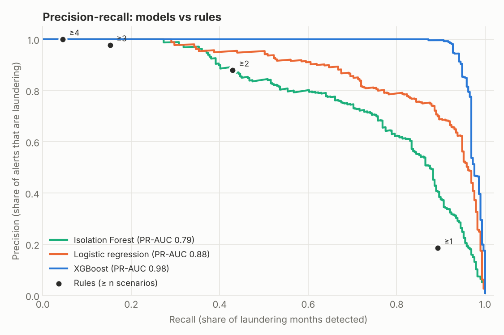
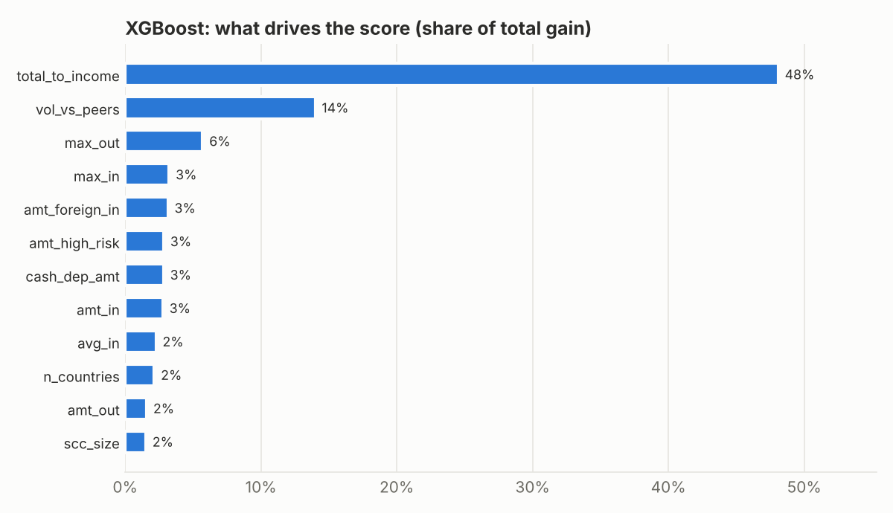

# AML Transaction Monitoring: rules + machine learning on synthetic bank data

End-to-end anti-money-laundering (AML) transaction monitoring pipeline, built on a
fully synthetic bank so that every step can be published and reproduced.

> **Status: work in progress.** Steps 1-3 (synthetic data, rule-based scenarios,
> features and machine learning) are complete. Threshold calibration is next
> (see roadmap).

## Why this project

Transaction monitoring in banks still relies mostly on rule-based scenarios with
fixed thresholds. They are explainable and auditable, but generate a very high share
of false positives. This project reproduces, on public synthetic data, the approach
of my Master's thesis (*A Machine Learning Approach to Financial Crime Detection*):

1. classic rule-based scenarios, as used in production TxM systems;
2. behavioural and network features at customer level;
3. ML models (Isolation Forest, gradient boosting) to score and prioritise alerts;
4. threshold calibration with Above-the-Line / Below-the-Line testing and an
   explicit cost function.

## Step 1: the synthetic bank

`src/amltm/generate.py` simulates a retail and corporate bank over 6 months.
Default run (`seed=42`):

| | |
|---|---|
| Customers | 5,000 (85% retail, 15% business) |
| Accounts (incl. external counterparties) | 15,236 |
| Transactions | 1,076,090 |
| Laundering transactions | 2,946 (0.27%) |
| Laundering customers | 100 (2.0%) |

**Normal behaviour:** salaries and pensions, card spending, bills and rent, P2P
transfers inside a friendship network, cash withdrawals; for businesses, client
receipts, suppliers and monthly taxes.

**Legitimate look-alikes**, included on purpose to create realistic false positives:

| Profile | What it does | Customers |
|---|---|---:|
| Remitters | monthly transfers to family abroad, occasionally larger | 439 |
| Cash-intensive businesses | bars, shops: daily cash deposits | 177 |
| Collectors | club treasurers, group trips: many small incoming transfers, then one payment | 126 |
| Cash side income | tips, side jobs: cash deposits well above declared income | 136 |
| One-off large operation | e.g. a house sale | 74 |
| High-risk trade | businesses trading with a partner in a high-risk country | 63 |

**Six laundering typologies** (FATF / FIU red flags), labelled at transaction and
customer level:

| Typology | Pattern | Customers | Transactions |
|---|---|---:|---:|
| Structuring | many cash deposits just below the threshold, then an outgoing wire | 25 | 735 |
| Fan-in / fan-out (money mule) | many unrelated senders, funds leave within days | 25 | 1,531 |
| Cycle (round-tripping) | A → B → C → A with small fees at each hop | 15 | 51 |
| High-risk jurisdiction | wires to/from high-risk countries, inconsistent with profile | 15 | 172 |
| Pass-through | large inflows forwarded abroad within 1-3 days, split up | 10 | 133 |
| Dormant account burst | near-dormant account suddenly moves large amounts | 10 | 324 |



*The high-risk country list in `config.py` is illustrative, not the official FATF list.*

## Step 2: rule-based scenarios

`src/amltm/rules.py` implements six scenarios of the kind found in production
TxM systems. Thresholds are fixed and set from business logic, with separate
thresholds for retail and business customers where volumes differ.

| ID | Scenario | Condition |
|---|---|---|
| S1 | Structuring | ≥ 3 cash deposits between 8,000 and 10,000 EUR within 7 days |
| S2 | High-risk jurisdiction | any wire ≥ 1,000 EUR to/from a high-risk country |
| S3 | Rapid movement of funds | ≥ 20,000 EUR in (50,000 for businesses) within 3 days and ≥ 80% out again |
| S4 | Fan-in | ≥ 6 distinct senders in 7 days (40 for businesses) |
| S5 | Activity spike | 30-day volume ≥ 5× the previous 90-day average and ≥ 25,000 EUR |
| S6 | Cash vs declared income | 30-day cash deposits ≥ 2× declared monthly income and ≥ 5,000 EUR (retail) |

Alerts are generated once per account, scenario and month, as in a monthly alert
batch. An alert counts as **productive** when the customer is a launderer in the
ground truth (a proxy for an alert escalated to a suspicious activity report).

### Results

| Scenario | Alerts | Customers alerted | Productive alerts | Precision |
|---|---:|---:|---:|---:|
| S1 Structuring | 76 | 27 | 73 | 96% |
| S2 High-risk jurisdiction | 321 | 121 | 84 | 26% |
| S3 Rapid movement of funds | 121 | 68 | 97 | 80% |
| S4 Fan-in | 328 | 154 | 78 | 24% |
| S5 Activity spike | 119 | 65 | 57 | 48% |
| S6 Cash vs declared income | 625 | 146 | 99 | 16% |
| **All rules** | **1,590** | **460** | **488** | **31%** |





**What the rules show**

- **Coverage is high, precision is not.** The rules catch 95 of the 100 launderers,
  but 69% of the 1,590 alerts are false positives. Each one costs analyst time.
- **The noisiest rules are the broadest.** S6 (cash vs income) and S4 (fan-in) produce
  60% of all alerts, mostly on legitimate collectors and customers with cash side income.
  S2 fires on every legitimate trade with a high-risk country.
- **Precise rules are narrow.** S1 (structuring) is 96% precise because it targets one
  very specific pattern; it says nothing about the other five typologies.
- **The 5 launderers no rule catches are all businesses** (3 fan-in/fan-out, 2
  pass-through). Their suspicious flows are hidden inside normal business volumes,
  which segment-level fixed thresholds cannot separate.
- **Precision depends on prevalence.** Launderers are 2% of customers here, far more
  than in a real portfolio, so real-world precision of the same rules would be much
  lower. This is why the next steps focus on **ranking alerts by risk**, not only on
  raising alerts.

## Step 3: features and machine learning

### From transactions to customer-months

`src/amltm/features.py` turns the 1 million transactions into a table with one row
per **account and month** (30,000 rows), the same unit as the monthly rule alerts, so
rules and models are compared on exactly the same rows. The label is 1 when the
account touched at least one laundering transaction that month (289 rows, 0.96%).

| Family | Features |
|---|---|
| Volume | number and amount of incoming / outgoing transfers, largest transfer, average inflow |
| Cash | cash deposits (count, amount), deposits just below the threshold |
| Counterparties | distinct senders, distinct receivers, number of foreign countries |
| Geography | foreign inflows and outflows, amounts with high-risk countries |
| Profile | volume and cash vs declared income, in/out balance, segment, KYC rating, nationality |
| History and peers | volume vs the account's own previous months, vs the segment median |
| Network | PageRank on the monthly transfer graph; size of the strongly connected component of large internal transfers (round trips) |

### Models

| Model | Type | Why |
|---|---|---|
| Isolation Forest | unsupervised | needs no labels: flags what is unusual |
| Logistic regression | supervised, linear | simple, fully explainable baseline |
| XGBoost | supervised, gradient-boosted trees | captures non-linear combinations of features |

Supervised models are evaluated with **5-fold cross-validation grouped by customer**:
all months of a customer are either in training or in test, so no model is ever scored
on a customer it was trained on. Every row gets an out-of-fold score.

### Results

| Model | PR-AUC | Alerts to match the rules' detection | Alert reduction |
|---|---:|---:|---:|
| Rules (any scenario) | 0.48 | 1,391 | – |
| Isolation Forest | 0.79 | 632 | −55% |
| Logistic regression | 0.88 | 365 | −74% |
| XGBoost | 0.98 | 259 | −81% |

The rules flag 1,391 customer-months and detect 89% of laundering months. **To reach
the same detection rate, XGBoost needs 259 reviews instead of 1,391 (−81%)**. Even the
unsupervised Isolation Forest, which never sees a label, halves the workload. At the
rules' own workload XGBoost also finds the 5 business launderers that no rule caught.







The most useful features are **relative**, not absolute: volume compared with declared
income (48% of the gain) and with peers in the same segment (14%). This is the core
argument for ML over fixed thresholds: one threshold cannot fit a pensioner and a
wholesaler, a ratio to the customer's own profile can.

### Stress test: schemes the model has never seen

A supervised model can only learn patterns present in its training labels. To measure
how much it depends on them, each typology in turn is **removed from training** and
the model is asked to rank its customers anyway.

| Typology | Rules: launderers caught | XGBoost PR-AUC, typology seen | XGBoost PR-AUC, typology never seen |
|---|---:|---:|---:|
| Cycle | 100% | 0.87 | **0.29** |
| Dormant burst | 100% | 1.00 | 1.00 |
| Fan-in / fan-out | 88% | 0.98 | 0.83 |
| High-risk country | 100% | 0.89 | 0.86 |
| Pass-through | 80% | 1.00 | 0.98 |
| Structuring | 100% | 0.99 | 0.86 |

Most schemes stay detectable because they share generic red flags (volumes far above
the profile, unusual counterparties). **Cycles do not**: each hop of a round trip looks
like an ordinary large transfer, and without labelled examples the model cannot tell
that money is coming back. Here a dedicated rule or a graph-based detector remains
necessary, so ML should **complement** the rules, not replace them.

### Limitations

- **Synthetic data flatters every model.** The laundering patterns were designed and
  are cleaner than real ones; real-world PR-AUC would be far lower. The value of this
  step is the method (grouped validation, comparison at equal workload, stress test),
  not the absolute numbers.
- **Labels are complete here.** In a bank, labels come from past investigations and
  SARs, so they are few, delayed and biased towards what the rules already catch.
- **Explainability.** A score must be justified to auditors and regulators. Feature
  importance is a first step; per-alert explanations (e.g. SHAP) would be needed in
  production.

## Quick start

```bash
git clone https://github.com/brunodibartolo/aml-transaction-monitoring.git
cd aml-transaction-monitoring
pip install -r requirements.txt
python scripts/generate_data.py          # writes data/ (~20 MB, ~30 s)
python scripts/plot_data_overview.py     # step 1 figure
python scripts/run_rules.py              # step 2: alerts, tables and figures
python scripts/run_models.py             # step 3: features, models, comparison (~1 min)
pytest -q                                # 24 tests
```

## Project structure

```
aml-transaction-monitoring/
├── src/amltm/
│   ├── config.py        # simulation parameters
│   ├── generate.py      # synthetic bank: customers, accounts, transactions
│   ├── io.py            # load generated data (parquet or csv.gz)
│   ├── rules.py         # six rule-based scenarios and their evaluation
│   ├── features.py      # customer-month features, incl. PageRank and round trips
│   └── models.py        # Isolation Forest, logistic regression, XGBoost, evaluation
├── scripts/             # command-line entry points
├── tests/               # pytest suite (data, rules, features, models)
├── reports/             # figures and result tables used in this README
└── data/                # generated data (not versioned)
```

## Roadmap

- [x] Synthetic data generator with six labelled typologies and legitimate look-alikes
- [x] Rule-based scenarios with evaluation by scenario and typology
- [x] Customer-month features: profile ratios, history and peer comparison, PageRank, round trips
- [x] Models: Isolation Forest, logistic regression, XGBoost; grouped cross-validation; unseen-typology stress test
- [ ] Threshold calibration: ATL/BTL testing and cost function
- [ ] Results and discussion

## Author

Bruno Di Bartolo, MSc Financial Engineering (University of Padua / ESILV Paris).
[GitHub](https://github.com/brunodibartolo) · [LinkedIn](https://www.linkedin.com/in/brunodibartolo)

## License

MIT
